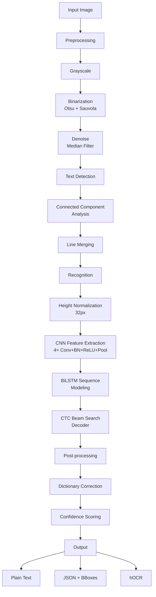

<div align="center">

# ⚡ ferritext

**Blazing fast, tiny OCR engine in pure Rust.**

[](https://github.com/redbasecap-buiss/ferritext/actions/workflows/ci.yml)
[](https://opensource.org/licenses/MIT)
[](https://crates.io/crates/ferritext-core)

*A Tesseract alternative under 80MB. Bindings for Python, C++, C#, and Julia.*

</div>

---

## ✨ Features

- 🦀 **Pure Rust** — No external ML frameworks (no ONNX, PyTorch, or TensorFlow)
- ⚡ **Blazing Fast** — Custom CRNN architecture optimized for inference speed
- 📦 **Tiny Footprint** — Binary <5MB, model <30MB, total package <80MB
- 🌍 **Multi-Language** — Latin, German, French, Spanish, Italian, Portuguese, Dutch
- 🔗 **Universal Bindings** — Python (PyO3), C++ (header-only), C# (P/Invoke), Julia (ccall)
- 📄 **Multiple Output Formats** — Plain text, JSON with bounding boxes, hOCR

## 🏗️ Architecture



### Model Architecture

| Layer | Type | Shape | Params |
|-------|------|-------|--------|
| Conv1 | Conv2D 3×3 + BN + ReLU + MaxPool | 1→32 | 320 |
| Conv2 | Conv2D 3×3 + BN + ReLU + MaxPool | 32→64 | 18,496 |
| Conv3 | Conv2D 3×3 + BN + ReLU + MaxPool | 64→128 | 73,856 |
| Conv4 | Conv2D 3×3 + BN + ReLU + MaxPool | 128→128 | 147,584 |
| BiLSTM | Bidirectional LSTM | 128→256 | 263,168 |
| Linear | Fully Connected | 256→191 | 49,152 |
| **Total** | | | **~552K** |

## 🚀 Quick Start

### Rust

```rust
use ferritext_core::OcrEngine;

let engine = OcrEngine::new_random("eng");
let result = engine.ocr_file("document.png")?;

println!("Text: {}", result.text);
println!("Confidence: {:.2}", result.confidence);

for word in &result.words {
    println!("{} ({:.0}%) at [{},{},{},{}]",
        word.text, word.confidence * 100.0,
        word.bbox.x, word.bbox.y, word.bbox.width, word.bbox.height);
}
```

### Python

```python
import ferritext

engine = ferritext.PyOcrEngine(lang="deu")
result = engine.ocr("document.png")  # Returns JSON
print(result)
```

### C++

```cpp
#include "ferritext.hpp"

ferritext::OcrEngine engine("eng");
auto result = engine.ocr_file("document.png");
std::cout << result.json() << std::endl;
```

### C#

```csharp
using Ferritext;

using var engine = new OcrEngine("eng");
string result = engine.OcrFile("document.png");
Console.WriteLine(result);
```

### Julia

```julia
using Ferritext

engine = OcrEngine("eng")
result = ocr_file(engine, "document.png")
println(result)
```

## 📦 Installation

### Rust
```bash
cargo add ferritext-core
```

### Python
```bash
pip install ferritext
```

### C++ / C# / Julia
Download the shared library from [Releases](https://github.com/redbasecap-buiss/ferritext/releases) and use the appropriate binding file.

## 🏗️ Building from Source

```bash
git clone https://github.com/redbasecap-buiss/ferritext.git
cd ferritext
cargo build --release
```

### Run Tests
```bash
cargo test --workspace --exclude ferritext-py
```

### Python Bindings
```bash
cd ferritext-py
pip install maturin
maturin develop
```

## 📊 Benchmarks

> ⚠️ Benchmarks use random (untrained) model weights. Real performance will vary.

```bash
cargo run --release --example basic
```

## 🗺️ Roadmap

- [ ] Pre-trained Latin model weights
- [ ] GPU acceleration (optional feature)
- [ ] PDF input support
- [ ] Table detection
- [ ] Handwriting recognition
- [ ] WASM support

## 📄 License

MIT License — see [LICENSE](LICENSE).

## 🤝 Contributing

Contributions welcome! Please open an issue first to discuss what you'd like to change.

---

<div align="center">
<i>Built with 🦀 and ❤️</i>
</div>
